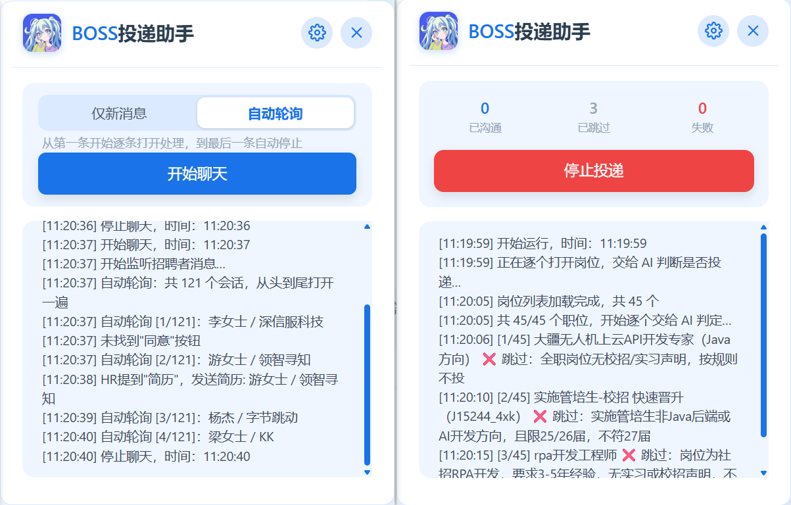

  

# BOSS投递助手

> BOSS直聘高效投递工具：AI 判断岗位 + 批量投递 + 聊天页自动跟进，提示词可自定义。
>
> **作者：wok** ｜ **v2.4.0** ｜ [官网](https://hyglgithub.github.io/boss-delivery-assistant/) ｜ [下载最新版](https://github.com/hyglgithub/boss-delivery-assistant/releases/latest) ｜ [更新日志](CHANGELOG.md)

## 功能

- **AI 智能判断**：岗位要求 + 简历 + 投递要求交给 AI，只投匹配岗位。
- **批量投递**：自动滚动收集、逐个打开详情，通过后点「立即沟通」。
- **聊天页跟进**：「仅新消息」只看顶部一条；「自动轮询」从列表头到尾逐条处理并自动停止。
- **提示词可自定义**：自然语言写要求，`{jobTitle}`、`{jobDescription}` 自动替换。
- **运行统计**：实时显示已沟通 / 已跳过 / 失败。

## 安装

1. 安装 [Tampermonkey](https://www.tampermonkey.net/)（Chrome / Edge）。
2. 从 [Releases](https://github.com/hyglgithub/boss-delivery-assistant/releases/latest) 下载压缩包，或把根目录 `boss-quick-apply.user.js` 全文粘贴到 Tampermonkey 新建脚本并保存。
3. 打开 BOSS 职位列表页：<https://www.zhipin.com/web/geek/jobs>，在右侧面板设置 API 和提示词后点「开始投递」。

## 文档

- [完整使用说明](https://hyglgithub.github.io/boss-delivery-assistant/#guide)
- [常见问题](https://hyglgithub.github.io/boss-delivery-assistant/#faq)
- [开发说明](src/README.md)
- [更新日志](CHANGELOG.md)

## 免责声明

本脚本仅用于个人求职效率提升。自动投递属于对 BOSS 直聘的自动化操作，可能触及平台风控；请自行控制频率并遵守平台用户协议，使用后果由使用者自行承担。

## License

MIT
